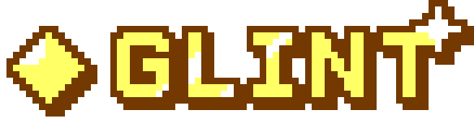
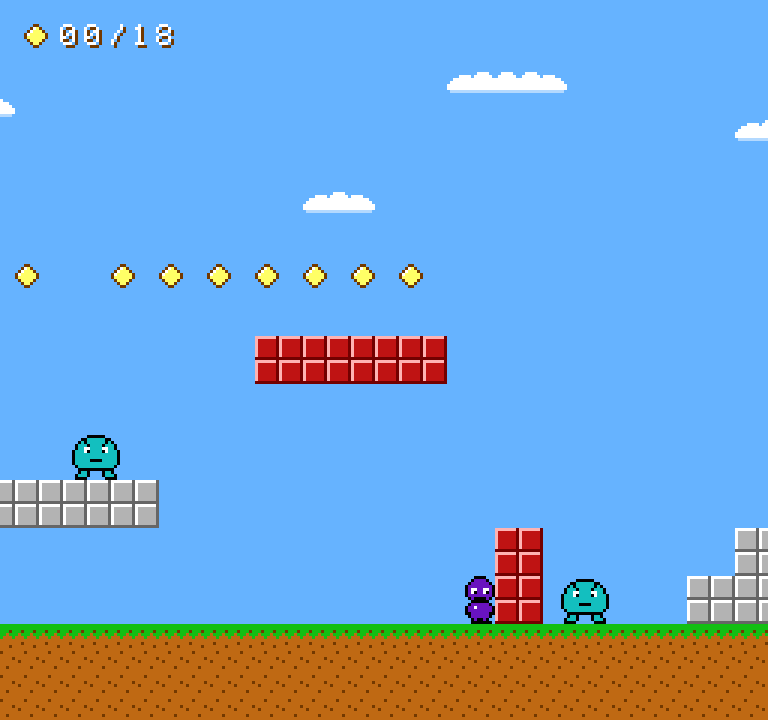
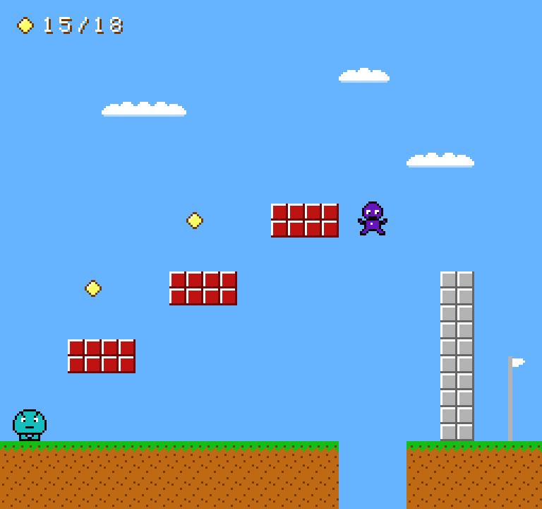
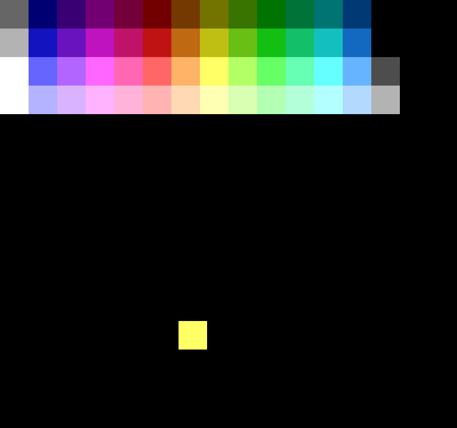
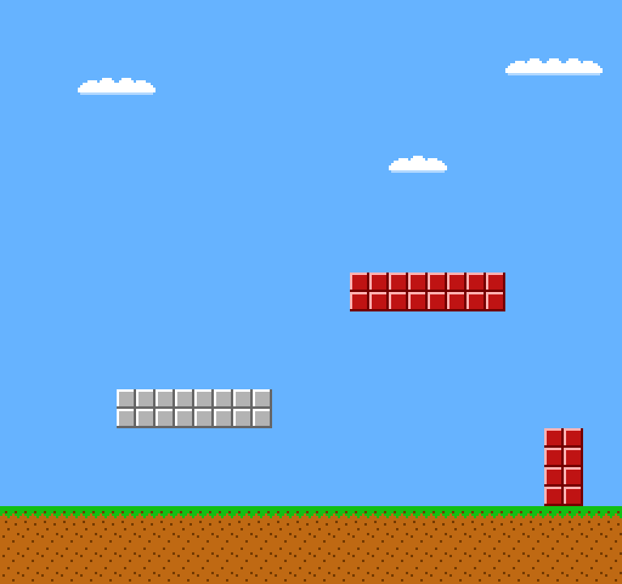
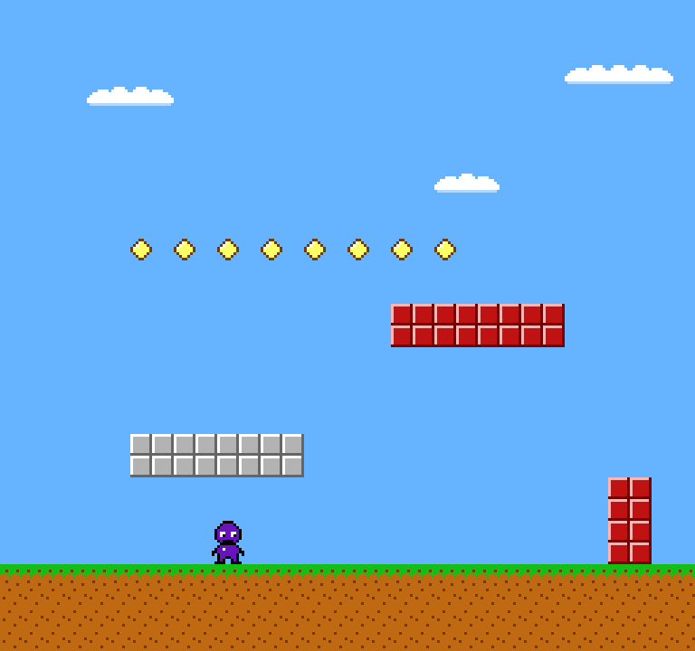
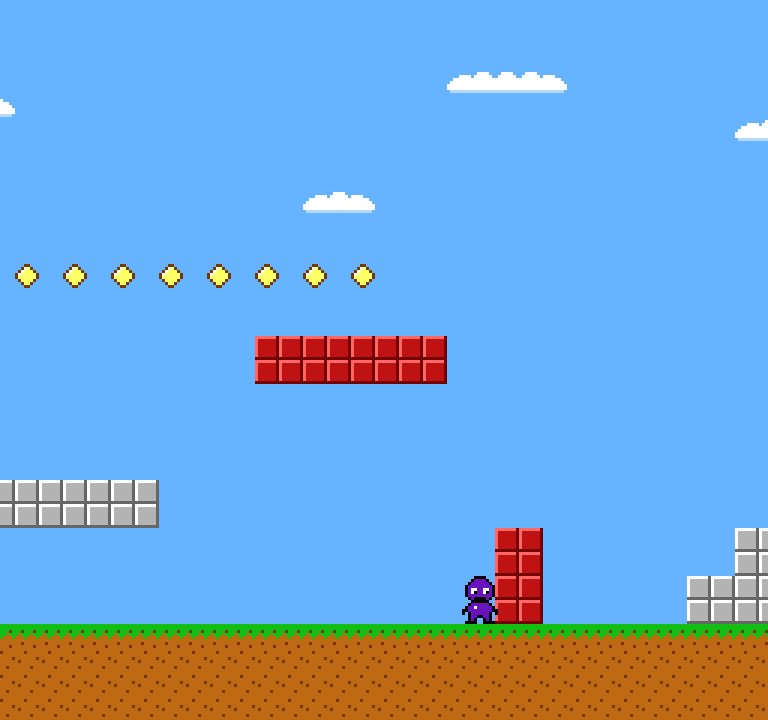

<p align="center">
  
</p>

# Glint

An 8-bit style platformer engine in Rust, built to the limits of the consoles it imitates, with a small demo game on top.



Glint draws everything the way an 8-bit console did: a 256×240 screen, 8×8 tiles, a fixed 64-colour palette, and hard caps on sprites. The name comes from the shimmer on the bricks, which is done by changing a single palette entry.

## Running it

You need Rust 1.85 or newer.

```bash
cargo run
```

It runs on macOS and Linux.

### Linux

Building needs the ALSA and libudev development files (for sound and gamepads) and `pkg-config`:

| Distribution | Install |
|---|---|
| Fedora | `sudo dnf install gcc pkgconf-pkg-config alsa-lib-devel systemd-devel` |
| Debian, Ubuntu | `sudo apt install build-essential pkg-config libasound2-dev libudev-dev` |
| Arch | `sudo pacman -S base-devel alsa-lib systemd-libs` |

On an immutable Fedora such as Silverblue or Bazzite, build inside a toolbox or distrobox with the Fedora packages above. To `cargo run` from inside the container as well, it also needs the window, graphics and sound libraries: `sudo dnf install libX11 libXi libglvnd-glx libglvnd-egl mesa-dri-drivers pipewire-alsa`. The binary it builds, `target/debug/glint`, also runs directly on the host.

The window uses X11, so on a Wayland desktop it runs through XWayland. Gamepads are read from `/dev/input`, which needs the usual desktop permissions.

## Controls

| Console button | Keyboard | Gamepad | In the demo |
|---|---|---|---|
| D-pad | Arrow keys or A / D | D-pad or left stick | Run |
| A | X, K or Space | Cross (bottom face button) | Jump; hold for a higher jump |
| B | Z or J | Square (left face button) | Hold to run faster |
| Start | Enter | Options | Pause |
| Select | Right Shift or Tab | Create | Change the hero's colour |

Press M to mute or unmute the music and sound effects.

## The demo level



The level is three screens wide. Collect gems, stomp enemies by landing on them, jump the two pits, and reach the flag. Touching an enemy any other way, or falling into a pit, sends you back to the start. The wall before the flag is too tall to jump from the ground; the way over is from the top brick step.

## Sound and music

Nothing is recorded. Every sound is a list of notes that a small software sound chip turns into audio when the game starts. The music is written as text, one step per eighth note, where a name starts a note, `.` holds it and `-` is a silence:

```text
E5 G5 C6 .  G5 .  E5 .  |  D5 E5 G5 .  .  .  -  .  |
```

The level theme is 16 bars for four voices and loops. It falls silent while the game is paused.

## The console limits

| Limit | Value |
|---|---|
| Screen | 256×240 pixels, scaled up by whole numbers only |
| Game clock | 60 ticks a second, independent of the display's frame rate |
| Master palette | 64 colours; a pixel is an index, never an RGB value |
| Background colours | One shared backdrop plus four palettes of three colours |
| Tiles | 8×8 pixels, 2 bits per pixel, stored as two bitplanes; 256 per table |
| Palette choice | Per 16×16 block of the background, not per tile |
| Sprites | 8×8, three colours plus transparent, at most 64 on screen |
| Sprites per line | At most 8 on any horizontal line; extras are not drawn |
| Movement | Whole numbers in 1/256ths of a pixel, no floating point |
| Sound | Pulse, triangle and noise waves with 16 volume steps |
| Music | Four voices: two pulse, one triangle, one noise |

Where Glint knowingly differs from real hardware: the whole level is kept in memory rather than streamed in while scrolling, sound effects play on top of the music rather than borrowing its voices, sprites can sit partly off the left edge, and sprites cannot be placed behind the background.

## How the code is organised

All the code is in `src`. The engine and the demo game are kept apart: the game never touches the window, keyboard or speakers directly.

| Engine | What it does |
|---|---|
| `main.rs` | The main loop: read input, run ticks, draw, play sounds |
| `timing.rs` | Fixed 60 Hz timestep |
| `video.rs` | Master palette, palette memory and the framebuffer |
| `display.rs` | Shows the framebuffer in the window |
| `tiles.rs` | 8×8 tiles and the pattern table |
| `background.rs` | The scrolling tile map |
| `sprites.rs` | Sprite list and line-by-line sprite drawing |
| `input.rs`, `gamepad.rs` | The eight-button controller, fed by keyboard and gamepad |
| `physics.rs` | Sub-pixel bodies and tile collision |
| `camera.rs` | Scroll position that follows a target |
| `animation.rs` | Frame animation |
| `synth.rs`, `audio.rs` | The sound chip (waves, note names, written music, mixing), and playing its output |

| Demo game | What it does |
|---|---|
| `demo.rs` | The level, its rules and the gem counter |
| `player.rs` | How the hero moves and feels |
| `enemy.rs` | The patrolling enemy |
| `art.rs` | Tile drawings (as ASCII art) and palettes |
| `sfx.rs` | Sound effects, written as notes |
| `music.rs` | The level theme, written as four lines of music |

## Tests

```bash
cargo test
```

There are 80 tests. Because the game logic never touches the window or speakers, the tests can drive the whole demo with a scripted controller.

For a quick visual check, `GLINT_SNAPSHOT=out.png cargo run` saves the window after 60 ticks and exits. `GLINT_SNAPSHOT_TICKS` changes the tick count, and `GLINT_SNAPSHOT_HOLD` holds a controller byte down throughout (128 is Right).

## How it was built

Glint was built one system at a time. These screenshots are from earlier steps.

| | |
|---|---|
|  |  |
| Step 1: the game loop, framebuffer and master palette | Step 2: tiles and background palettes |
|  |  |
| Step 3: sprites, with 8 of the 10 gems drawn on their line | Step 7: scrolling |

The remaining steps added controller input, collision and physics, gamepad support, animation, the gem counter, enemies, sound effects and music.

## Dependencies

- [macroquad](https://crates.io/crates/macroquad) for the window, drawing and audio output
- [gilrs](https://crates.io/crates/gilrs) for gamepads

## Licence

MIT. See [LICENSE](LICENSE).
